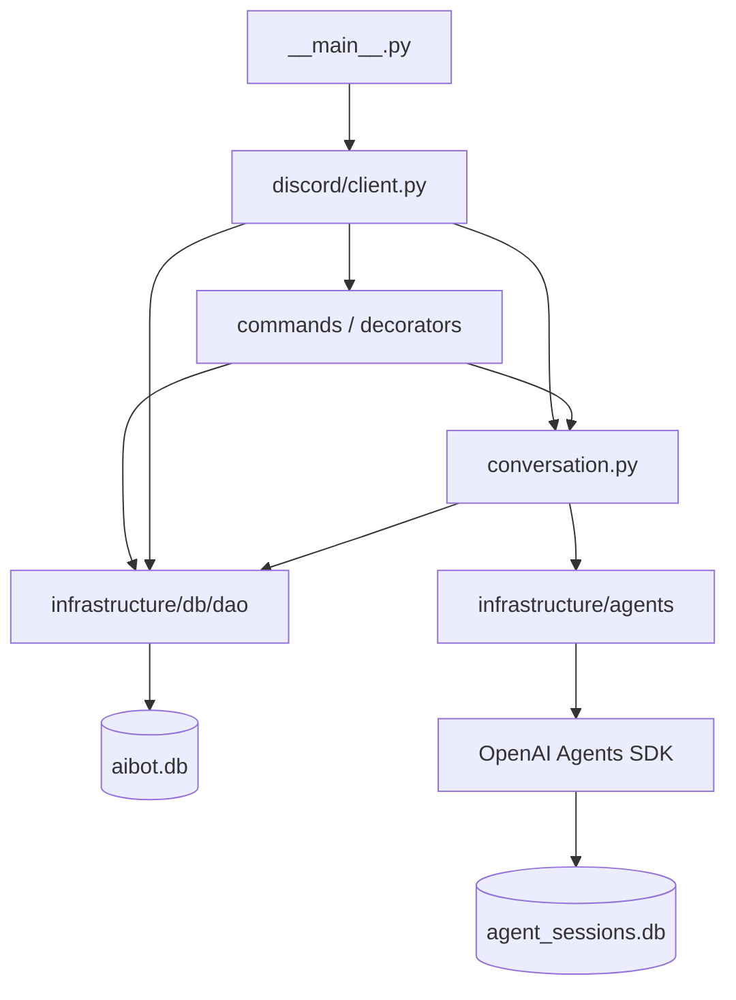

# ARCHITECTURE.md

`src/aibot/` は、Discordのスレッドを単位にAIとの会話を続けるbotの実装。
Discordとのやり取りと会話の進行を `discord/` が担当し、AIの実行とデータ保存を `infrastructure/` にまとめている。

## 構成と責務

| 場所 | 役割 |
|---|---|
| `__main__.py` | `.env` を読み込み、botを起動する |
| `discord/client.py` | クライアントを管理し、起動時のテーブル作成・コマンド登録と、投稿の受信を行う |
| `discord/commands/` | `/talk`・`/forget`・`/limit`・`/set-limit` の入力と応答を扱う |
| `discord/decorators/` | コマンド実行前に、共通のトークン上限判定を呼び出す |
| `discord/conversation.py` | 会話の対象確認、順番待ち、上限判定、AI呼び出し、使用量記録、返答送信をまとめる |
| `infrastructure/agents/` | エージェントの設定を読み込み、OpenAI Agents SDKで返答生成と会話履歴の保存・削除を行う |
| `infrastructure/db/dao/` | `aiosqlite` とSQLで、上限・使用量・会話スレッドの登録情報を読み書きする |

以下は主要な呼び出し関係。`logger.py` は各処理から共通で利用する。

## 会話の流れ

`/talk` は質問の入力画面を開き、送信された質問から公開スレッドを作る。
スレッドと作成者をDBに登録して最初の返答を生成し、その後の投稿も `conversation.py` で処理する。
返答の対象は、登録済みスレッドの作成者による文章の投稿に限る。

返答処理は、上限判定 → AI実行 → 使用量記録 → Discordへの送信、の順に進む。
上限はコマンド実行時と入力送信時にも確認し、順番待ちの間に使用量が増えた場合に備えて返答直前に再確認する。

AIの設定は `resources/agents.yml` から読み込む。
`general`（未定義なら先頭のエージェント）が返答を担当し、他のエージェントを必要に応じて呼び出せるツールとして持つ。
実行結果は、返答文と使用トークン数などの情報を含む辞書で会話処理に返す。

## 保存と処理の境界

| 保存先 | 内容 | 管理するもの |
|---|---|---|
| `aibot.db` | 個別・全体のトークン上限 | `UserTokenLimitDao` |
| `aibot.db` | ユーザーと日本時間の日付ごとの使用量 | `DailyTokenUsageDao` |
| `aibot.db` | 会話スレッドと作成者の対応 | `TalkThreadDao` |
| `agent_sessions.db` | `talk:<スレッドID>` ごとの会話履歴 | SDKの `SQLiteSession` |

DAOは操作ごとに接続を開き、更新の確定と接続の終了まで担当する。
会話履歴は `Runner` が `SQLiteSession` を通じて読み書きするため、独自の履歴用DAOは置いていない。
登録情報と履歴がファイルに残るので、再起動後も同じスレッドで会話を続けられる。
保存先は作業ディレクトリで、Dockerでは `/app/data` 全体を名前付きボリュームで永続化する。

上限は個別設定、全体設定（`user_id=0`）、環境変数 `MAX_DAILY_USAGE` の順に決まる。
Discordの管理者権限を持つメンバーは上限判定を免除するが、使用量は記録する。
判定は実行前の累計に対して行うため、1回の返答で上限を超えることはある。

会話の順序はスレッド単位のロックで守り、使用量の記録と返答の送信までを順番待ちの対象にする。
同じユーザーが別スレッドに投稿した場合も、ユーザー単位のロックで上限判定と加算を直列に行う。
この制御はbotを1プロセスで動かす前提になっている。

`/forget` は作成者だけが実行でき、同じスレッドのロックを使って返答の完了後に履歴を消す。
Discord上の投稿、使用量、スレッドの登録情報は残す。
会話履歴の自動削除・要約・取得件数制限は行っていない。

操作方法と起動に必要な設定は [CONVERSATION.md](CONVERSATION.md) を参照。
